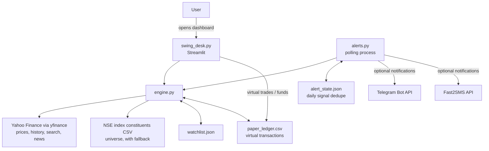

# Swing Desk

Swing Desk is a local stock research and paper-trading application for NSE-listed shares. It combines a Streamlit dashboard, a shared technical-analysis module, a virtual portfolio stored as CSV, and an optional background process that sends threshold alerts. Market data and headlines come from Yahoo Finance through `yfinance`; the application does not connect to a broker or place orders.

The dashboard's trade controls update a **virtual ledger only**. The alert worker reports possible actions through Telegram and/or Fast2SMS when configured. Treat scores, headline tone, and suggested levels as rule-based research outputs, not investment advice.

## Features

- Track an editable NSE-symbol watchlist and view recent prices and trend scores.
- View candlesticks, moving averages, RSI, support/resistance estimates, and rule-based recommendations.
- Generate virtual buy/sell suggestions with configurable position sizing and risk limits.
- Track virtual cash, positions, profit/loss, and an XIRR estimate; back up or restore the CSV ledger.
- Scan a Nifty 500 universe (or a built-in fallback list) for trend and relative-strength candidates.
- Optionally poll prices during Indian market hours and send once-per-day-per-signal alerts.

## Technology stack

| Component | Technology |
| --- | --- |
| Dashboard | Python, Streamlit |
| Market data and symbol/news search | `yfinance` (Yahoo Finance) |
| Data calculations and local ledger | pandas, NumPy |
| Charts | Plotly |
| Notifications and HTTP | requests, python-dotenv, Telegram Bot API, optional Fast2SMS API |
| Local persistence | JSON and CSV files |

Dependencies are listed without version pins in [`requirement.txt`](requirement.txt). The project does not declare a required Python version. Use a currently supported Python 3 release compatible with the latest versions of these packages.

## Project files

| File | Purpose and interactions |
| --- | --- |
| [`swing_desk.py`](swing_desk.py) | Streamlit entry point. Builds the dashboard, loads market data and indicators from `engine.py`, manages watchlist edits, computes suggestions, and writes virtual trades or funding entries to the ledger. |
| [`engine.py`](engine.py) | Shared market-data, indicator, scoring, recommendation, watchlist, ledger, and alert-rule functions used by the dashboard and alert worker. |
| [`alerts.py`](alerts.py) | Background alert entry point. Repeatedly reads the watchlist and virtual positions, fetches prices and trend scores, and optionally sends notifications. Importing or running this file starts its polling loop. |
| [`watchlist.json`](watchlist.json) | User-maintained list of NSE symbols. The dashboard can create it from built-in defaults if it is missing, then add or remove symbols. The alert worker reads the same file. |
| [`paper_ledger.csv`](paper_ledger.csv) | Append-oriented record of virtual deposits, withdrawals, buys, and sells. Both dashboard portfolio calculations and alert position checks read it. |
| [`alert_state.json`](alert_state.json) | Deduplication state for notifications already sent for a signal on a given date. `alerts.py` reads and updates it. |
| `.env` | Local, ignored file for alert credentials and optional worker settings. `alerts.py` loads it at startup; do not commit it. |
| [`.env.example`](.env.example) | Safe template showing the supported environment variable names, with no credentials. Copy it to `.env` and fill in your values. |
| [`requirement.txt`](requirement.txt) | Python package requirements. Install with the exact singular filename shown below. |
| [`start_alerts.bat`](start_alerts.bat) | Windows launcher for `alerts.py`. It no longer stores credentials; the worker reads them from `.env`. The launcher deletes `alert_state.json` before starting. |
| `New Text Document.txt` | Empty/unrelated text file in the repository; it is not read by the application. |

There are no required database, broker, or server-side components. Runtime caches are held in memory and are not separate project files.

## Architecture and execution flow



### Dashboard flow

1. Streamlit starts `swing_desk.py`. It loads the watchlist, using built-in defaults only when `watchlist.json` does not exist.
2. The app loads Nifty data, calculates the market regime and then downloads each watchlist symbol's history. It reads the virtual ledger to reconstruct cash and open positions and fetches recent prices.
3. The five tabs render the watchlist, a chart and recommendation, trade suggestions, the virtual portfolio, and a market scan. Some data functions are wrapped in Streamlit caches with different time-to-live values.
4. Watchlist controls write `watchlist.json`. Selected trade suggestions, deposits, withdrawals, CSV restores, or the explicit fresh-start action write `paper_ledger.csv`.

### Alert-worker flow

1. Running `python alerts.py` reads optional environment settings and `alert_state.json`, then immediately enters a continuous loop.
2. During weekdays from 09:15 to 15:30 India time, it reads the watchlist and reconstructs open virtual positions from the ledger. `ALWAYS` bypasses the time check when set to a non-empty value.
3. Trend scores and ATR values refresh about every 30 minutes; one-minute Yahoo price data is fetched on each polling cycle.
4. Stop, target, weak-trend, and qualifying watchlist buy conditions are checked. A signal is printed and optionally sent to configured services, then recorded in the state file to avoid repeating it that day.
5. The worker sleeps for `CHECK_SECONDS` (60 by default) and repeats. Ctrl+C stops it.

## Analysis and trading logic

### Indicators and trend score

`engine.indicators()` adds the following to historical OHLC data:

- Exponential moving averages (EMA) over 20, 50, and 200 closes.
- 14-period Wilder-style RSI using exponentially smoothed gains and losses.
- MACD histogram: the 12/26 EMA difference less its 9-period EMA signal line.
- 14-period smoothed average true range (ATR), used to estimate risk distances.

`engine.score()` awards up to 100 points:

| Condition | Points |
| --- | ---: |
| Close above EMA50 | 20 |
| Close above EMA200 | 20 |
| EMA20 above EMA50 | 15 |
| RSI between 50 and 70 inclusive | 15 |
| MACD histogram positive | 15 |
| Three-month price return above the Nifty's three-month return | 15 |

The three-month comparison uses approximately 63 trading intervals (`iloc[-64]`). The dashboard uses this score for watchlist labels and suggestions; the alert worker uses it for entry and weak-trend checks.

The dashboard classifies the broader regime from whether Nifty is above its EMA200. It scales deployable capital to 100% when above EMA200 and EMA50 is above EMA200, 70% when above EMA200 otherwise, and 40% below EMA200.

### Recommendations and market scan

For a selected chart, `engine.recommend()` combines the trend score, a 15-point penalty when the market is risk-off, a headline keyword tilt clamped to plus/minus 10, and a 10-point penalty when RSI is above 75. It clamps the final rating to 0–100 and maps ratings to BUY, BUY ON DIP, WATCH, HOLD, or SELL / AVOID labels. Headline tone is a simple count of positive and negative keywords; it is not sentiment analysis. The chart also reports the last 20 sessions' low/high as support/resistance and suggests a stop at 2 ATR below price and target at 4 ATR above price.

The Top performers tab downloads the Nifty 500 constituents CSV from NSE when available and otherwise uses a static built-in symbol list. `engine.scan()` computes the same trend score plus one- and three-month returns, then sorts by score and three-month return. The dashboard can add selected scan results to the watchlist.

### Virtual portfolio and risk sizing

The Suggestions tab calculates a stop at `price - ATR × stop multiplier` and a target at twice the stop distance above price (a 2:1 reward/risk level). Suggested quantity is the lower of:

- Capital × risk percentage divided by the per-share stop distance.
- The maximum single-stock allocation divided by share price.

It then limits the total number of suggested buys, the count per theme, and total deployment after the cash buffer and market-regime factor. These are suggestion-generation controls; they do not guarantee a portfolio-wide risk limit after edits or subsequent trades.

Trades in the UI are virtual. `engine.book()` replays ledger rows to calculate cash, average buy cost, current open quantities, stored stop/target levels, and cash-flow dates. A 0.15% assumed cost is applied to buys and sells. Deposits and withdrawals feed the XIRR cash flows. The dashboard displays portfolio equity and unrealized P&L using available market prices. There is no broker integration and no order execution.

The alert worker checks open virtual positions for price at/below stop, price at/above target, or trend score below 45. For symbols not held, it emits a buy signal when score meets `MIN_SCORE` (65 by default), with alert levels at 2 ATR below and 4 ATR above the current price. Alerts do not update the virtual ledger or automatically sell holdings.

## External data and configuration

| Source/configuration | Use |
| --- | --- |
| Yahoo Finance via `yfinance` | Historical and one-minute prices, symbol search, and headlines. NSE symbols are suffixed with `.NS`; Nifty 50 is queried as `^NSEI`. |
| NSE website CSV | Nifty 500 constituents, fetched from `nsearchives.nseindia.com`; a static fallback universe is used if that request fails. |
| Telegram Bot API | Optional alert delivery. Configure `TELEGRAM_TOKEN` and `TELEGRAM_CHAT_ID` in `.env` or the process environment. |
| Fast2SMS | Optional SMS alert delivery. Configure `FAST2SMS_KEY` and `SMS_NUMBER` in `.env` or the process environment. |

`alerts.py` loads `.env` from the project directory using `python-dotenv`. Values already set in the process environment take precedence. Supported settings:

| Variable | Default | Meaning |
| --- | --- | --- |
| `TELEGRAM_TOKEN` | unset | Telegram bot token. |
| `TELEGRAM_CHAT_ID` | unset | Destination chat identifier. |
| `FAST2SMS_KEY` | unset | Optional Fast2SMS authorization key. |
| `SMS_NUMBER` | unset | Destination number for Fast2SMS. |
| `MIN_SCORE` | `65` | Minimum score for an unheld watchlist symbol to trigger a buy alert. |
| `CHECK_SECONDS` | `60` | Delay between polling cycles. |
| `ALWAYS` | unset | Any non-empty value bypasses weekday/market-hours gating; use carefully. |

The dashboard's capital, risk percentage, position count, cash buffer, theme cap, score threshold, and ATR stop multiple are Streamlit controls, not environment variables. Network access is required for current market data, scanning, and headlines. Yahoo Finance data may be delayed or unavailable.

## Data files

- `watchlist.json` is a JSON array of symbols. The application sorts and de-duplicates values when saving. It does not validate that manually edited entries are real NSE symbols.
- `paper_ledger.csv` has columns `date,symbol,side,qty,price,stop,target`. `side` is expected to be `BUY`, `SELL`, `DEPOSIT`, or `WITHDRAW`. Funding rows use the `CASH` symbol and place the amount in `price`; trade rows represent virtual share quantities and prices.
- `alert_state.json` maps date-and-signal keys to sent markers. It can grow over time; the Windows launcher currently deletes it at every launch, which resets de-duplication history.

These files are plain local data. Back them up before restoring or clearing the ledger, and do not commit private portfolio data to a public repository. The `.env` file is excluded by `.gitignore`; keep it local and private.

## Installation and execution

Run these commands from the project root with Python and pip installed. The filenames below match the repository exactly.

### macOS / Linux

```sh
python3 -m venv .venv
source .venv/bin/activate
python -m pip install --upgrade pip
python -m pip install -r requirement.txt
cp .env.example .env
python -m streamlit run swing_desk.py
```

Before running alerts, edit `.env` and fill in the credentials you want to use. Do not overwrite an existing `.env` when updating or reinstalling. Open the local URL printed by Streamlit. To run the alert worker in a separate terminal, activate the same environment and use:

```sh
python alerts.py
```

Leave Telegram variables unset if Telegram delivery is not wanted. To stop the worker, press Ctrl+C.

### Windows PowerShell

```powershell
py -m venv .venv
.\.venv\Scripts\Activate.ps1
python -m pip install --upgrade pip
python -m pip install -r requirement.txt
Copy-Item .env.example .env
python -m streamlit run swing_desk.py
```

Before running alerts, edit `.env` and fill in the credentials you want to use. Do not overwrite an existing `.env` when updating or reinstalling. In a second PowerShell window, activate the environment and start the worker:

```powershell
\.venv\Scripts\Activate.ps1
python alerts.py
```

Running the alert worker can contact notification APIs when matching alerts occur. The Windows batch launcher now uses the same `.env` file through `alerts.py`.

## Known issues and suggested improvements

### Security and operational issues

- **The Telegram credential was previously stored in `start_alerts.bat`.** It has been moved to the ignored local `.env` file, and the launcher no longer contains it. Because it was previously present in code, rotate the Telegram bot token and replace the value in `.env`; if the old launcher was committed, remove the old credential from repository history as well. This README intentionally does not include credential values.
- The batch file deletes `alert_state.json` before each run, so restarting it permits same-day alerts to be sent again and discards deduplication history.
- The batch file changes to a fixed `E:\Python\swingdesk` directory, which will fail on other machine layouts.
- `ALWAYS` is checked as a raw string, so values such as `0` still bypass market-hour checks. Market-hour logic also does not account for exchange holidays.

### Data and calculation robustness

- Yahoo Finance is an unofficial data dependency and requests can fail, be rate-limited, return empty data, or change shape. Several per-symbol errors are silently ignored; the initial Nifty fetch in the dashboard is not guarded and can prevent the app from loading if data is unavailable.
- `alerts.py` loads JSON state without validation and writes it directly. Invalid/truncated JSON can stop startup; an interrupted write can corrupt state. Atomic writes and a recovery path would help.
- Watchlist JSON, ledger columns, dates, trade sides, prices, quantities, and restored CSVs are not fully validated. In particular, editable quantities are not checked for positivity, and ledger replay assumes well-formed, chronologically ordered rows.
- The portfolio has no realized/unrealized tax treatment, corporate-action handling, slippage model, or reliable real-time pricing. The fixed 0.15% cost is only an estimate.
- XIRR and portfolio values can be unavailable or misleading with missing, invalid, or unusual cash flows; XIRR is shown as `n/a` when a root is not found in its fixed search interval.
- `engine.signals()` contains shared alert logic, but `alerts.py` duplicates these checks instead of calling it. Keeping one implementation would reduce drift.
- The score and headline rules are heuristic and do not model fundamentals, liquidity, transaction costs beyond the simple fixed estimate, or out-of-sample strategy performance. Thresholds should be evaluated before relying on them.

### Practical improvements

1. Rotate the previously exposed Telegram credential and keep alert secrets in the ignored `.env` file or process environment.
2. Add schema and range validation for watchlists, ledgers, restored uploads, and alert configuration; reject negative quantities and invalid trade actions.
3. Make JSON/CSV writes atomic, preserve alert state across restarts, and log data/API failures with enough context to diagnose them.
4. Centralize alert generation in `engine.signals()`, add market-calendar handling, and make timezone handling explicit with a named India timezone.
5. Pin and document tested dependency/Python versions; add unit tests for indicator calculations, score rules, sizing, ledger replay, and alert deduplication.
6. Separate data-fetching from presentation, make the Yahoo/NSE data providers replaceable, and add freshness indicators for cached or delayed prices.
